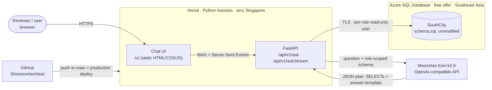
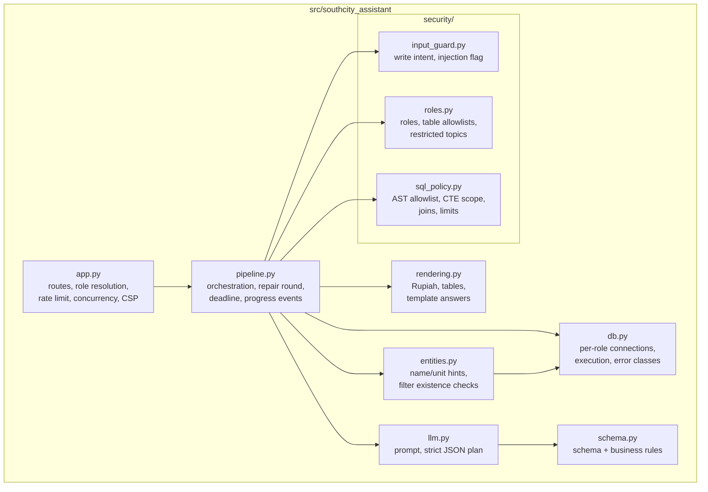
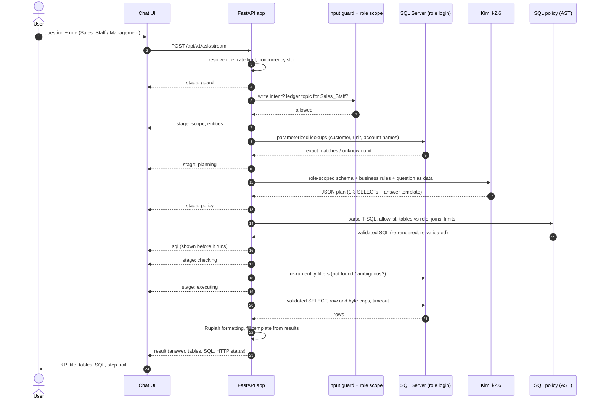
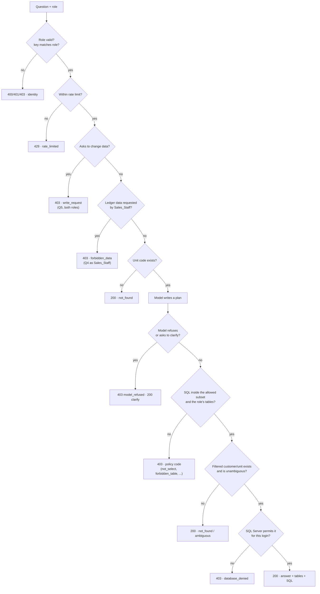
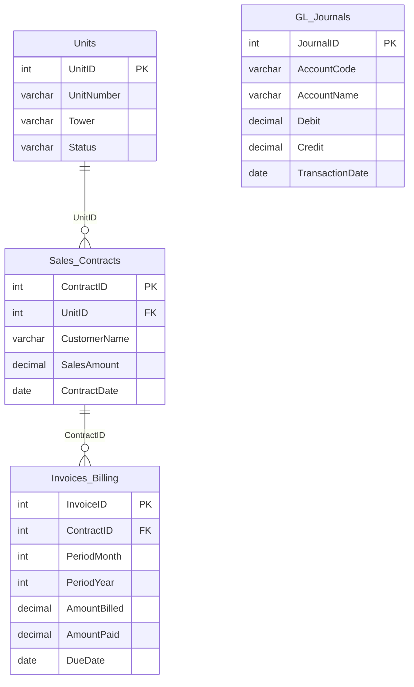
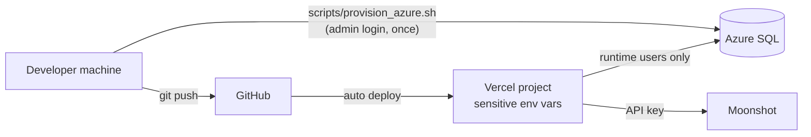

# System design

How the SouthCity AI Data Query Assistant is put together, from the deployment down to a single request.
The security reasoning behind these choices is in [`SECURITY.md`](SECURITY.md).

## 1. System context

Locally the same code runs with `uvicorn` and SQL Server 2022 in Docker instead of Vercel and Azure; nothing in
the application changes, only the environment variables.

## 2. Components

## 3. Request workflow

One question, end to end. Each `stage` arrow is a progress event the UI shows live; the request stops at the first
layer that refuses (see section 4).

If SQL Server reports a syntax or column error, the plan goes back to the model once with a sanitized error
message, and the policy, checking and executing steps run again on the new plan. Policy rejections, permission
errors and timeouts are never retried.

## 4. Where a request can be refused

The last check, SQL Server's own permissions, holds even if every check above it were bypassed: the runtime logins
cannot write, and the Sales_Staff login is explicitly denied `GL_Journals`.

## 5. Data model and access per role

| Table | `Sales_Staff` (login `southcity_sales`) | `Management` (login `southcity_mgmt`) |
|---|---|---|
| Units, Sales_Contracts, Invoices_Billing | SELECT | SELECT |
| GL_Journals | **DENY** | SELECT |
| Any table: INSERT / UPDATE / DELETE / ALTER / EXECUTE / CREATE | DENY | DENY |

## 6. Deployment and secrets

| Secret | Where it lives | Who uses it |
|---|---|---|
| Azure SQL admin password | Local `.env.azure` (gitignored) | Provisioning script only; never deployed |
| `southcity_sales` / `southcity_mgmt` passwords | Azure (as the users' credentials) and Vercel (sensitive, write-only) | The app at runtime |
| Kimi API key | Vercel (sensitive, write-only) and local `.env` | The app at runtime |
| Local Docker passwords | Local `.env` (gitignored) | Local runs only |

None of these are in the repository. Sensitive Vercel variables cannot be read back from the dashboard or CLI,
only used by the running function. The browser never receives a secret: it only calls the app's own API.

## 7. Key design decisions

- **Plain pipeline, no agent framework.** One model call plus at most one repair is a straight line; plain code is
  easier to audit than a LangChain/LangGraph graph.
- **The model never touches the database.** It returns a plan; only SQL that passed the policy runs, under a login
  that cannot write.
- **The model never writes figures.** Numbers in the answer come from result placeholders.
- **Same code everywhere.** Local Docker, tests and the cloud demo differ only in environment variables.
